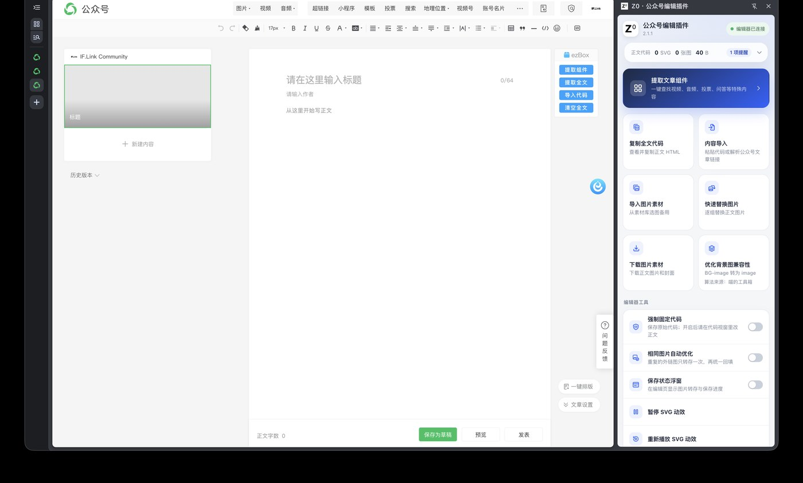
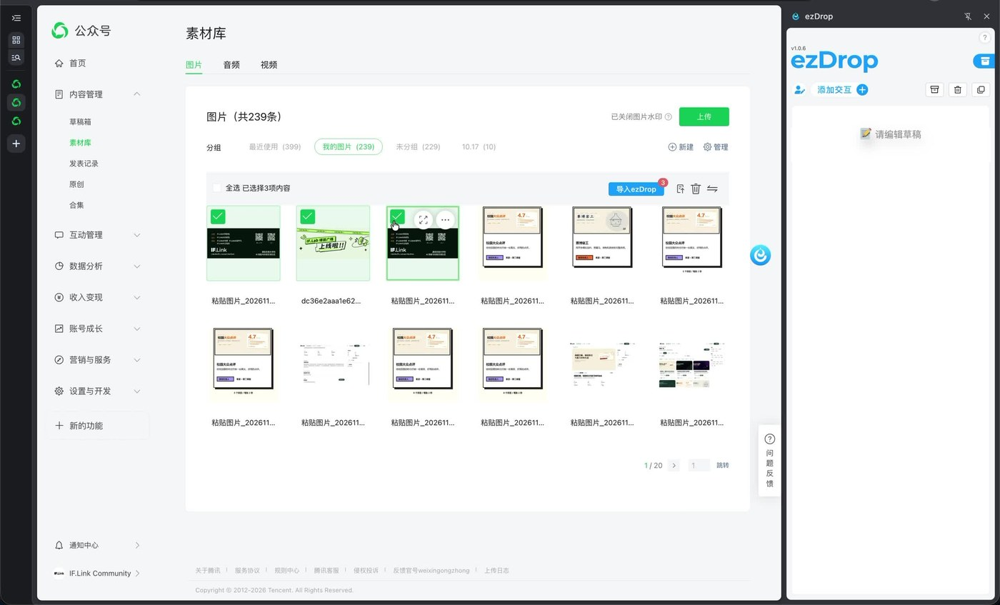
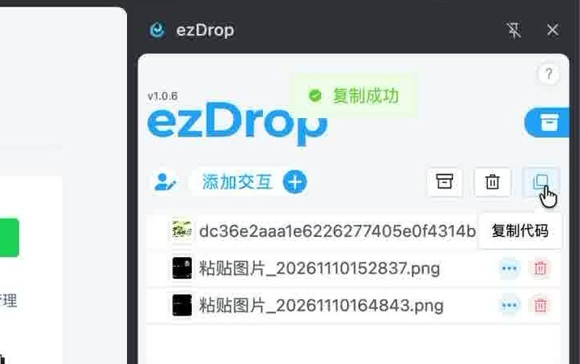
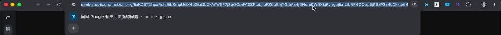

# Authoring Toolchain：插件、导入与素材链接

公众号编辑器不是浏览器，不能把网页原样搬进去。把 HTML / 设计稿 / SVG 变成可粘贴的公众号图文，社区目前靠两个浏览器插件，加一条把图片换成公众号图床固定链接的流水线。本文记录黄东迩 2026-11-14 在群里的演示与说明。

## 0. 什么时候看这篇

- 手上是 HTML / Figma 导出 / React 页面，要改成公众号里的 SVG
- SVG 导入编辑器后掉字、图案错位、动效不跑
- 需要 `mmbiz.qpic.cn` 的图片固定链接，才能把图内联进 `<image href>`
- 想知道「只做一节 SVG、其余转图片」怎么做

## 1. 两个插件

| | ezDrop | Z0 公众号编辑插件 |
| --- | --- | --- |
| 官网 | <https://ezdrop.cn> | <https://plugin.zer0n.cn> |
| 形态 | 公众号编辑页右侧栏 | 公众号编辑页右侧栏 |
| 费用 | 可免费使用；官网另有「免费领取专业版」入口 | 免费（ZER0N Studio 出品） |
| 版本 | 演示时 v1.0.6 | v2.1.1（2026-10-31） |
| 主要用途 | 导入 / 提取 SVG 组件、提取全文 HTML、复制代码 | 导入前检查、保住原始代码、图片转存 |



*左：公众号编辑器里的 ezBox 面板；右：Z0 的侧栏工作台。截图来自 2026-11-14 群内演示。*



*素材库勾选图片后，工具栏浮出「导入 ezDrop」。*



*导入后 ezDrop 面板列出图片，点工具栏的「复制代码」按钮，提示「复制成功」。*

### ezDrop

- **SVG 排版**：一键导入、局部导入、组件提取、组件美化
- **提取全文**：把整篇文章的 HTML 抽出来；也用来取图片固定链接（第 3 节）
- 代码盒子、模板、草稿箱、收藏夹、发布后修改
- 官方说明：不绑定公众号，图片不传到第三方服务器

### Z0

安装：Chrome 应用商店或 Edge 加载项商店；国内打不开商店时，官网提供 crx / zip 离线包和[安装教程](https://zer0n.cn/archives/cha-jian-an-zhuang-jiao-cheng)。

导入：

- 一键导入 SVG 动画，覆盖整篇或插入光标位置；东迩推荐用它导入
- 也能解析公众号文章链接，填好正文、标题、摘要和封面

导入前检查（这几项最容易被忽略）：

- 长度达到 2048 个字符的属性会被公众号编辑器**整条删除**，长动画路径首当其冲
- 重复的外链图片、没填的「阅读原文」会单独提示
- 每一项都可以一键开启对应的保护

保住代码与素材：

- **强制固定代码**：导入时打开，保存时提交原始代码，长动画路径完整保留；刷新后自动恢复
- **相同图片自动优化**：同一张外链图出现多次时只转存一次，其余位置统一回填
- 从素材库选图、逐组替换正文图片；按需或批量下载正文图片和封面
- **优化背景图兼容性**：把 SVG 里的背景图转成图片，提升兼容性
- 暂停 / 继续 / 重新播放 SVG 动效
- 侧栏信息条：SVG 数、图片张数与总大小、字数、代码体积

## 2. 标准流水线

1. 公众号后台新建图文，进入编辑页，确认 Z0 侧栏显示「编辑器已连接」
2. 导入：Z0 覆盖整篇 / 插入光标，或 ezDrop 局部导入。导入时先看检查项
3. 打开**强制固定代码**再保存，否则超长属性（含动画路径）会被删
4. 保存草稿 → **手机预览**。桌面编辑器看不出窄屏错位
5. 按症状修：掉字 / 图案错位走第 4 节；动效不跑查 `SKILL.md` 的 AttributeName 白名单
6. 发布前再预览一次；发布后仍可用 ezDrop 的「发布后修改」改

## 3. 取公众号图片固定链接

正文图片最终都在 `mmbiz.qpic.cn` 上。要让一张图进 SVG 的 `<image href="...">`，先拿到它的固定地址。

### 3.1 古法：勾选图片 → 导入 ezDrop → 复制代码

1. 公众号后台 › 素材库 › 图片，勾选目标图片（可多选）
2. 点浮出工具栏的「导入 ezDrop」
3. 右侧 ezDrop 面板列出已导入的图片，点工具栏的「复制代码」按钮（提示「复制成功」）
4. 贴给 AI，明确说明：**忽略 ezDrop 相关包裹代码，只保留正文和图片地址**
5. 代码里的 `` 就是图片固定链接

整篇也行：用 ezDrop 的「提取全文」或 Z0 的「复制全代码」拿到全文 HTML，同样找 ``。

东迩演示时取出的代码（节选）：

```html
<section class="ezDrop" powered-by="ezDrop" data-wechat="ezDrop"
         label="ezDrop 微信SVG交互图文排版插件 版权所有"
         style="overflow: hidden;line-height: 0;margin-bottom: 0px;">
  
</section>
```

- 外层 `section.ezDrop`、`powered-by`、`data-wechat` 都是插件包裹，不要带进成品
- `&amp;` 是 HTML 转义；放进 HTML / SVG 属性时保持 `&amp;`，不要手工改成裸 `&`
- `wx_fmt=png` 决定图片格式，别删

### 3.2 单张图：先显示原图

东迩原话：「这样操作可以读取到单个图片的链接（一定要显示原图后再提取链接）」。

在 Z0 的「已入库图片」或公众号素材库里打开图片，先「查看原图」，再复制图片地址（可以在预览上右键「复制图片地址」，也可以直接在新标签页打开、复制地址栏）。



*打开原图后，浏览器地址栏就是 `https://mmbiz.qpic.cn/...?wx_fmt=...` 形式的固定链接。*

没显示原图就复制，拿到的不是最终那张图的地址。

### 3.3 用进 SVG

```xml
<image x="0" y="0" width="609" height="639"
       href="https://mmbiz.qpic.cn/.../640?wx_fmt=png&amp;from=appmsg" />
```

- 图片要先在公众号上传 / 出现过一次，再取链接
- 直接写外链图，编辑器会转存；转存后的地址才稳定。开启 Z0 的「相同图片自动优化」后，同一张外链图只转存一次
- 拿不准链接是否稳定时，先保存草稿再回读代码，看看编辑器把 `href` 改成了什么

## 4. 字与图案的兜底

SVG 里的字不是"字体"，是路径或图。复杂字直接排版几乎必然出错。

| 症状 | 做法 |
| --- | --- |
| 粗体、空心字、异形字显示不出来 | 让 AI 把这几个字转成 SVG 路径（或单独的小图），再内联进主 SVG |
| 图案（运行的盒子、插画等）内部错位严重 | 整块导出 PNG → 上传公众号素材库 → 取固定链接 → 用 `<image>` 嵌入 |
| 整段静态排版错位 | 不要硬转 SVG，整段截图当图片 |
| 只需要一点动效 | 首段用 SVG 动效，后面转图片或 GIF |

东迩原话：

> 有一些粗体字现在似乎显示不出来，这种可以直接让 AI 把粗体字、空心字和异形字转成一个 svg 图片，然后内联到整个 svg 组件去，一些图案（比如说上面运行的盒子啊什么的）也可以这样。如果图案内部错位严重，直接转成一张图片上传到后台，然后把链接复制下来给 ai 让它嵌入 svg 也可以。

## 5. 降级策略：不是整篇都要 SVG

梁宇凡：「把 html 转成 svg 还是太难了」，同时想保留「一开始 out of box 的感觉」。讨论后的做法是分段降级：

- 没有动效和交互的段落，直接转图片
- 需要一点循环动效，转成 GIF（梁宇凡：「不过可以转成 GIF」）
- 「那就那一节 svg，后面都图片也可以的」——只有真正需要交互 / 动效的那一节做 SVG

不要为了「整篇纯 SVG」把静态段落也硬转：错位和掉字的修复成本，远高于图片方案。

## 6. 参考

- <https://svg.show/home> — SVG 动效案例
- <https://leapage.cn> — 仍在内测的工具，出自给多家大厂做过公众号的工作室
- 群内演示录屏：2026-11-14 00:11–00:22（ezDrop 取图片地址、Z0 导入 SVG、单张图取链接）

## 7. 验收清单

- [ ] 手机预览无错位、无掉字
- [ ] 保存后 SVG 动效仍能播放（强制固定代码已打开）
- [ ] 所有 `<image href>` 都是 `mmbiz.qpic.cn` 固定链接，无临时 / 外链地址
- [ ] 超长属性没有被编辑器删掉
- [ ] 「阅读原文」已填

## 来源

2026-11-14 00:11–00:22 黄东迩在群内的操作演示与文字说明，梁宇凡提出整理进仓库；插件能力以 <https://ezdrop.cn> 与 <https://plugin.zer0n.cn> 在 2026-11-14 的页面为准。

文中截图仅用于说明插件界面，版权归对应工具方。
